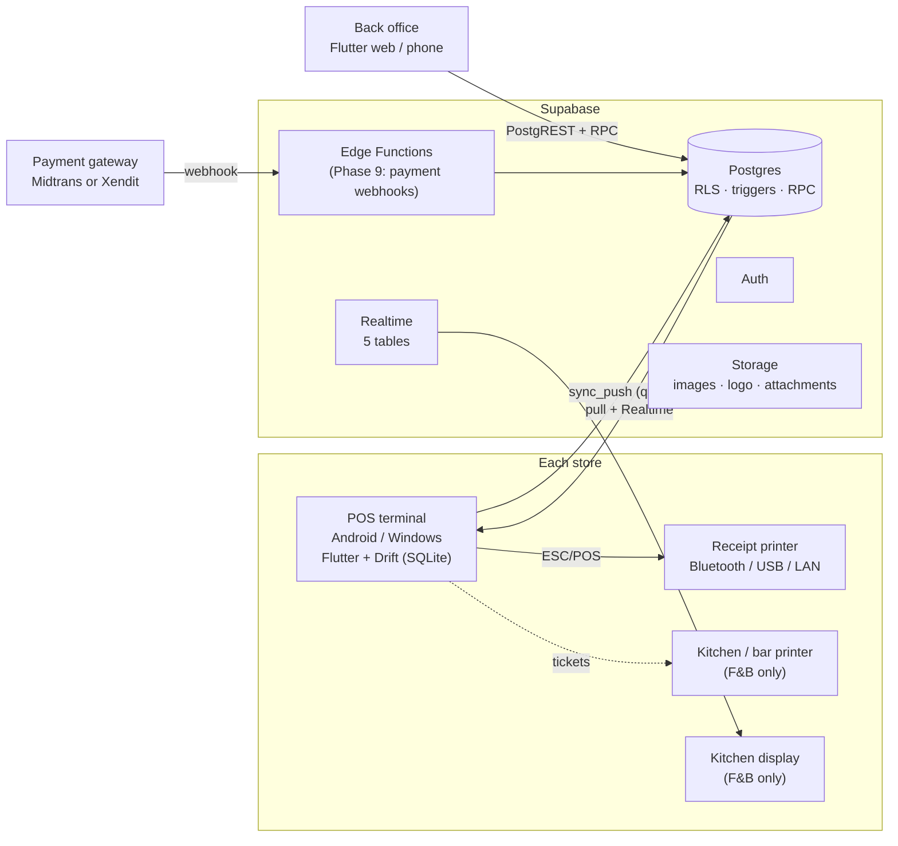
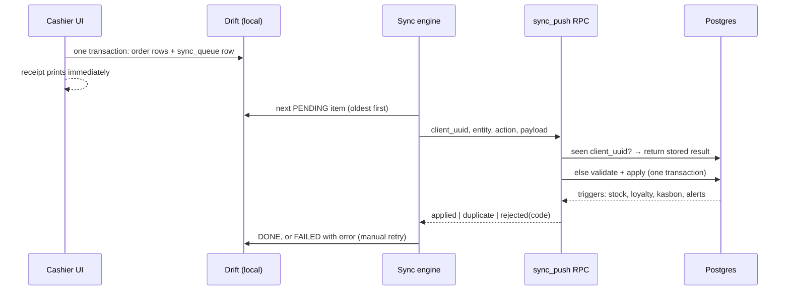

# CashierA: Phase 0 Architecture

| | |
|---|---|
| Status | Phase 0 (this document). Phase 1 (database) is delivered alongside it. |
| Date | 2026-11-05 |
| Toolchain checked | Flutter 3.47.8 · Dart 3.13.7 · Node 24 · Supabase CLI 3.0.0 |

---

## 1. What we are building

CashierA is a multi-store point of sale and back office for a retail chain of 3 to 4 stores. Cashier terminals keep working without internet and sync when the connection returns. The back office runs on Supabase. The scope is comparable to Indonesian cloud POS products, with original branding.

| Person | Device | Main jobs |
|---|---|---|
| Owner | Phone or web | All stores: catalog, prices, promos, staff, reports |
| Branch manager | Web and the store terminal | Own store: PIN approvals, stock, shifts, reports |
| Cashier | Store terminal | Sell, take payment, print receipts, open and close shifts |
| Inventory clerk | Store terminal or web | Receiving, stock opname, transfers |
| Kitchen (F&B stores only) | Kitchen screen | Ticket status |

## 2. Decisions

### 2.1 Confirmed by you

- Brand **CashierA**, app id `com.cashiera.pos`.
- Tax default: **PPN 11% included in the price**, set per store. Since 2025 the statutory rate is 12% on a DPP of 11/12, so the effective rate stays 11%.
- Rounding: **none**. Each store can later switch to nearest, up or down, to Rp 50, 100, 500 or 1.000.
- Seed: **demo data now**, plus a CSV template (`docs/templates/products-template.csv`) for loading your real catalog.
- From your brief: RETAIL business, Bahasa Indonesia and English, integer Rupiah, the five payment methods, the fixed tech stack, and the phase order.

### 2.2 My calls (assumptions you can overturn)

| # | Assumption | Why |
|---|---|---|
| A1 | One company per Supabase project, so tables have no `tenant_id` | Simpler and faster RLS. Turning it into a SaaS later is a migration. |
| A2 | 3 demo stores: CashierA Pusat (`PST`), Bekasi (`BKS`), Tangerang (`TGR`), all on WIB | Adding a 4th store is a single insert, and it inherits default settings and payment methods |
| A3 | Demo staff: 1 owner, 1 manager per store, 2 cashiers per store, 1 inventory clerk | Matches your account list |
| A4 | Terminals: Android tablet with a Bluetooth 58mm printer, and Windows PC with a USB/LAN 80mm printer, both supported. Android is tested first | Your brief named both. Printer models are still open |
| A5 | Payment gateway: a mock behind a `PaymentGateway` interface until Phase 9 | Gateway not chosen yet |
| A6 | Loyalty: 1 point per Rp 10.000 of net spend (after discounts and points); redeem 1 point = Rp 100 (1% back); balance shared across stores | Redeem value wasn't specified |
| A7 | Kasbon needs a named customer, is due in 30 days by default, and is repaid at the store that issued it | Keeps receivables within one store, which matches the RLS model |
| A8 | Each product has a "taxable" flag, because sembako such as beras, gula and telur are exempt from PPN | Correct receipts for mixed baskets |
| A9 | Manual discounts above 20% need manager approval (set per store) | Your threshold |
| A10 | Voiding after a receipt or bill was printed needs a manager PIN. Voids before printing need only the `pos.void` permission. Every void is audited | Your rule. Can be made stricter (all voids) later |
| A11 | PIN switching: staff tap their name, then enter a 4 to 6 digit PIN. There is no PIN-only login | See §4.3 |
| A12 | Offline on terminals: selling, payments, shifts, petty cash, refunds, kasbon repayments, stock adjustments, opname. Online only: catalog, purchasing, transfers, settings, reports | Back-office work happens with internet. The till never waits for it |
| A13 | F&B mode is built (Phase 8) but switched off for all three retail stores | Your stores are retail |
| A14 | Stock may go negative. Negative stock raises an alert and flags the order, and never stops the cashier | Your conflict rule |

## 3. System overview



## 4. Key design choices

### 4.1 One Flutter codebase, two shells

- **POS shell** (dark theme) runs on terminals: Android and Windows first, with iOS and macOS possible. It reads and writes the local Drift database and never blocks on the network.
- **Back-office shell** (light theme) runs on web, phone and desktop. It talks to Supabase directly and caches reads.
- The app picks the shell at startup. A paired terminal boots into POS, and a signed-in owner or manager boots into the back office. The web build only includes back-office routes, because browsers can't do Bluetooth or USB ESC/POS printing.
- Money, tax, promotions, shift and loyalty math live in a **pure-Dart package `cashiera_core`**. It has no Flutter imports, its unit tests run in seconds with `dart test`, and the same rules are re-checked by Postgres.

### 4.2 Offline-first write path



- **Local queue** (`sync_queue` in Drift): `id` (= client_uuid), `entity`, `action`, `payload` (JSON), `created_at`, `retry_count`, `status` (`PENDING`, `SYNCING`, `FAILED`, `DONE`), `last_error`, `next_attempt_at`.
- **Three idempotency layers**:
  1. `sync_inbox` stores every applied `client_uuid` with its result, so a retry returns the original answer.
  2. Every record uses a client-generated UUID (v7) primary key, so a re-sent row can't be duplicated.
  3. Orders carry a `version`. Stale snapshots are ignored, and completed orders can't be edited.
- **Retries**: network errors, 5xx responses and Postgres serialization or deadlock errors back off exponentially (2 s, 4 s, 8 s and so on, capped at 5 minutes, with jitter). Business-rule rejections (`rejected` with a code such as `payment_mismatch`) go to `FAILED` and show on a Sync screen with a manual retry. A failed item does not block unrelated items.
- **Server entities** (built in Phase 1): `shift.open`, `shift.close`, `cash_movement.create`, `order.upsert`, `order.void`, `order.mark_printed`, `refund.create`, `customer.upsert`, `receivable_payment.create`, `stock_adjustment.create`, `stock_opname.submit`, `audit.log`, `dining_table.status`, `kitchen.status`. Payload shapes are in [supabase/README.md §5](../supabase/README.md#5-sync-api-sync_pushclient_uuid-entity-action-payload).
- **Sync down**: catalog, prices, settings and staff are pulled with an `updated_at` cursor (with a 5-minute overlap so late commits aren't missed), and deletions arrive through `sync_tombstones`. Pulls run every 5 minutes, when the app resumes, and on manual refresh. Live store data (orders, order_status, stock_levels, dining_tables, shifts) comes through Realtime, plus a pull after every reconnect.
- **Header indicator**: online or offline, plus the count of `PENDING`, `SYNCING` and `FAILED` queue items.
- **Clocks**: the device stamps `ordered_at`, and the server stamps `received_at`. Phase 2 measures each device's clock offset on every sync and flags skews over 5 minutes.

### 4.3 Identity and PINs

- **Owners and managers** sign in to the back office with a Supabase Auth email and password. Any staff member can optionally have one.
- **Terminals are paired, not logged in.** A manager creates an 8-character pairing code in the back office (valid 15 minutes, single use). The terminal signs in anonymously and redeems the code with `pair_device`, which makes it a `devices` row bound to one store. Revoking a device cuts its access immediately, because every RLS check reads `devices.is_active`.
- **Staff switch on a terminal** by tapping their name and entering a PIN. PINs are bcrypt hashes from pgcrypto. Terminals cache their store's hashes in secure storage so PIN login works offline. Online verification locks a PIN for 5 minutes after 5 wrong tries.
- Every terminal write names the acting employee (`cashier_id`, `approved_by` and so on). The server checks that employee's role permissions and store assignment before applying anything.
- **Why name plus PIN, not PIN only:** checking one bcrypt hash takes about 0.1 to 0.3 s on a budget tablet. Checking every staff member's hash would take seconds.
- **Trust boundary:** a terminal is trusted for its own store. A stolen or rooted terminal could forge actions in that store until it is revoked. The mitigations are instant revocation, the audit log, server-side permission checks, and the fact that PIN hashes only reach that store's terminals.

### 4.4 Multi-store data and row-level security

- **Company-wide tables:** catalog (products, variants, modifiers, categories, units, suppliers, recipes), customers and loyalty, promotions and vouchers, payment methods, roles and permissions.
- **Store tables** carry `store_id NOT NULL`: stock, price overrides, reorder points, settings, tables, printers, shifts, orders and everything under them, inventory documents, expenses. They are indexed on `(store_id, created_at)` and `(store_id, business_date)`.
- One helper decides reads: `app.store_ids_with(permissions[])` returns the stores the caller may see for a module.

  | Caller | Stores |
  |---|---|
  | Owner (role scope `all_stores`) | all |
  | Manager, cashier, inventory, kitchen | stores assigned in `employee_stores` |
  | Paired terminal | its own store only |

- **Writes:** terminals never write store tables directly. Everything goes through validated RPCs (`sync_push` and friends). Back-office master data uses direct writes, guarded by permission policies.
- **Roles are editable** (`roles`, `role_permissions`). The `owner` role is locked: it always has every permission, and the last active owner can't be removed.

Default permissions per role:

| Permission | Owner | Manager | Cashier | Inventory | Kitchen |
|---|:-:|:-:|:-:|:-:|:-:|
| `pos.sell`, `pos.discount`, `pos.void` | ✓ | ✓ | ✓ | | |
| `pos.discount_override`, `pos.void_after_print`, `pos.refund`, `pos.open_drawer` (approvals) | ✓ | ✓ | | | |
| `shift.manage`, `shift.cash_movement` | ✓ | ✓ | ✓ | | |
| `customer.manage`, `kasbon.manage` | ✓ | ✓ | ✓ | | |
| `catalog.manage`, `promo.manage` (company-wide) | ✓ | | | | |
| `pricing.store_override` | ✓ | ✓ | | | |
| `inventory.view`, `inventory.adjust`, `inventory.opname`, `inventory.receive`, `purchase.manage`, `transfer.request` | ✓ | ✓ | | ✓ | |
| `transfer.approve` | ✓ | ✓ | | | |
| `reports.view`, `expense.manage`, `audit.view` | ✓ | ✓ | | | |
| `employee.manage`, `device.manage`, `settings.manage` | ✓ | ✓ | | | |
| `kitchen.view` | ✓ | ✓ | | | ✓ |

### 4.5 Money, quantities and tax

- **Money** is integer Rupiah everywhere: `bigint` in Postgres, `int` in Dart and Drift. It's displayed as `Rp 25.000` with `intl` (`id_ID`, 0 decimals).
- **Rates** are integer basis points (`1100` = 11%).
- **Quantities** are `numeric(14,3)` in Postgres, integer thousandths in Dart and Drift (`Qty.milli`), and a decimal string such as `"1.250"` in sync payloads. This supports items sold by the kg.
- **Rounding rule** (the only one): `divRoundHalfUp(n, d) = (2n + d) ~/ (2d)` for `n ≥ 0`. It gives exactly the same result as Postgres `round(n::numeric / d)`.
- **Order of calculation**, done in `cashiera_core` and re-checked by Postgres:
  1. Line gross = round((unit price + modifiers) × qty)
  2. Item discounts (manual, item promos) are subtracted per line
  3. Bill discounts (manual, bill promos, voucher), then points, are spread over the lines by largest remainder, so the line totals always add up to the bill exactly
  4. Service charge (if enabled) = round(Σ net × rate / 10000)
  5. Tax base = net of taxable lines, plus the service charge if it is taxable
     - inclusive: `tax = round(base × r / (10000 + r))`, grand total = Σ net + service
     - exclusive: `tax = round(base × r / 10000)`, grand total = Σ net + service + tax
  6. Rounding adjustment (store setting, default none)
  7. Tax is spread back over the taxable lines (largest remainder) for per-product tax reports
- **Example:** Rp 25.000 with 11% PPN included gives PPN Rp 2.477 and DPP Rp 22.523.
- **Postgres enforces it.** CHECK constraints hold each line's arithmetic and the order identities. When an order completes, the line sums must match the header, the payments must equal the grand total, and the tax must equal the formula. If the app and the database ever disagree, the sale is rejected loudly instead of being booked wrong.

### 4.6 Stock and conflicts

- Stock is kept per (store, variant). Every product has at least one variant, which is the SKU actually sold. Products with a recipe (BOM) deduct ingredients instead, which is the F&B case.
- Deduction happens in Postgres when an order changes to `completed`, through a trigger in one transaction. Stock rows are locked in variant-id order, so concurrent sales are exact and can't deadlock.
- **Conflict rule (yours):** orders are applied in arrival order, and stock may go negative. Negative stock raises a `STOCK_DISCREPANCY` alert and sets `orders.needs_review`. The cashier is never blocked.
- Every stock change writes `stock_movements` (type, delta, balance after, cost, reference). That history drives the movement report and stock valuation.
- A low-stock alert opens when a variant falls to its reorder point, and closes by itself after restocking.
- **Transfers** go `requested → approved → in_transit` (stock leaves the sender) `→ received` (stock enters the receiver). A shipped-versus-received difference raises `TRANSFER_DISCREPANCY`.
- **Goods receipts** update the variant cost by weighted average across all stores.

### 4.7 Printing

- `ReceiptDocument` is a pure-Dart layout (text, columns, bold, sizes, QR, logo). `EscPosEncoder` turns it into bytes (58mm = 32 columns, 80mm = 48 columns), and a `PrinterTransport` sends them.
- Transports: `flutter_thermal_printer` for Bluetooth classic and BLE, USB on Android, Windows and macOS, and network printers. Raw TCP to port 9100 as a fallback. PDF via `pdf` and `printing` for A4 output and sharing.
- The cash drawer opens through the printer (ESC p pulse). Opening it without a sale needs a manager PIN and is audited.
- Kitchen and bar tickets (F&B) route by product or category station to the printer whose purpose matches.

### 4.8 Payments

- A `PaymentGateway` interface provides `createQris(orderId, amount)`, which returns a QR string and expiry, plus a status stream and cancel. `MockGateway` is used until Phase 9, then a Midtrans or Xendit adapter runs inside an Edge Function, so server keys never touch a device. The gateway webhook updates `payments.status`, and Realtime tells the terminal.
- Offline, cashiers can still take cash, a static QRIS sticker, card, or transfer, each recorded with its reference or approval code. Dynamic QRIS needs internet.
- Split payment is several `payments` rows. Only cash rows have tendered and change amounts. Kasbon is recorded as a payment line that opens a receivable.

### 4.9 Language and formats

- `gen-l10n` with `app_id.arb` (default) and `app_en.arb`. Every string is translated, with no hard-coded text in widgets.
- Dates and "today" use each store's timezone (WIB, WITA or WIT). Orders store a `business_date` computed in that timezone.

### 4.10 Design system

- Tokens in `lib/core/design_system/tokens.dart`:
  - Dark POS colors: bg `#0F172A`, surface `#1E293B`, primary `#6366F1`, secondary `#14B8A6`, text `#F8FAFC`.
  - Light back-office colors: bg `#F8FAFC`, surface `#FFFFFF`, text `#1E293B`.
  - Status: `#10B981`, `#F59E0B`, `#EF4444`.
  - Spacing 4/8/12/16/24/32, radius 12/16, motion 150/250 ms.
- **Plus Jakarta Sans** is bundled as an asset (OFL license), so there are no runtime font downloads and offline terminals still look right.
- Below 600dp: bottom navigation and a slide-up cart sheet. At 600dp and above: a split view with 65% catalog and a 35% sticky cart. Touch targets are at least 48dp.
- Small `const` widgets, with no build method over about 80 lines. Every screen has skeleton loading (`skeletonizer`), an empty state, inline validation and toasts (`toastification`).

## 5. Folder structure

```text
CashierA/
├─ app/                          # Flutter app: POS shell + back-office shell
│  ├─ lib/
│  │  ├─ main.dart               # bootstrap: env, Supabase, Drift, ProviderScope
│  │  ├─ app/                    # App widget, router (go_router), shell selection
│  │  ├─ core/
│  │  │  ├─ config/              # env (dart-define), flavors, feature flags
│  │  │  ├─ database/            # Drift AppDatabase, tables, DAOs, migrations
│  │  │  ├─ sync/                # sync_queue, SyncEngine, PullService, Realtime listeners
│  │  │  ├─ network/             # Supabase client provider, connectivity
│  │  │  ├─ auth/                # device pairing session, PIN lock, current employee
│  │  │  ├─ printing/            # ReceiptDocument, EscPosEncoder, transports
│  │  │  ├─ payments/            # PaymentGateway interface, MockGateway
│  │  │  ├─ design_system/       # tokens, ThemeData (dark/light), shared widgets
│  │  │  ├─ l10n/                # app_id.arb, app_en.arb
│  │  │  └─ utils/               # formatters (Rp), clock, ids (UUID v7)
│  │  └─ features/
│  │     ├─ pairing/  pin_login/  catalog/  inventory/  cashier/  checkout/
│  │     ├─ receipts/  shifts/  customers/  kasbon/  promotions/  dashboard/
│  │     └─ reports/  employees/  settings/  fnb/  transfers/  purchasing/  finance/
│  ├─ test/                      # mirrors lib/ (unit, widget, sync tests)
│  ├─ integration_test/
│  └─ assets/                    # fonts/, images/
├─ packages/
│  └─ cashiera_core/             # pure Dart: Money, Qty, pricing, tax, rounding,
│                                #   promo engine, shift reconciliation, loyalty, kasbon
├─ supabase/
│  ├─ config.toml
│  ├─ migrations/                # versioned SQL (Phase 1)
│  ├─ seed.sql                   # demo data
│  ├─ tests/database/            # pgTAP tests (RLS, stock, sync, shifts…)
│  └─ functions/                 # Edge Functions (Phase 9)
├─ tools/db-test/                # runs migrations + tests on embedded Postgres (no Docker)
└─ docs/
   ├─ phase-0-architecture.md    # this file
   └─ templates/products-template.csv
```

Every feature folder has the same shape:

```text
features/<feature>/
├─ domain/        # entities (freezed), repository interfaces, use cases. No Flutter, no Supabase.
├─ data/          # Drift DAOs, Supabase data sources, mappers, repository implementations
└─ presentation/  # screens, widgets, Riverpod controllers (@riverpod Notifiers)
```

## 6. Packages

These were checked on pub.dev on 2026-11-05 and resolved together in a scratch project on Flutter 3.47.8 / Dart 3.13.7.

**App runtime**

| Package | Version | Use |
|---|---|---|
| flutter_riverpod | ^3.4.3 | State management |
| riverpod_annotation | ^4.0.7 | `@riverpod` code generation |
| freezed_annotation | ^3.1.0 | Immutable models |
| json_annotation | ^4.12.0 | JSON mapping |
| go_router | ^18.1.3 | Routing and guards |
| drift | ^2.35.3 | Local SQLite database |
| drift_flutter | ^0.3.1 | Drift setup with bundled SQLite on every platform |
| supabase_flutter | ^2.18.3 | Auth, PostgREST, Realtime, Storage |
| connectivity_plus | **7.3.1** (pinned) | Online/offline signal |
| mobile_scanner | ^7.5.0 | Camera barcode scanning (HID scanners need no package) |
| flutter_thermal_printer | ^2.3.0 | ESC/POS over Bluetooth, BLE, USB and LAN |
| pdf | ^3.13.1 | PDF receipts and reports |
| printing | ^5.15.1 | PDF preview, share, print to system printers |
| intl + flutter_localizations | ^0.20.3 / SDK | Rp formatting, dates, ID/EN |
| uuid | ^4.6.0 | Client-generated UUID v7 |
| flutter_secure_storage | ^11.2.0 | Device session, cached PIN hashes |
| bcrypt | ^1.2.0 | Offline PIN check, compatible with pgcrypto hashes |
| share_plus / url_launcher | ^13.3.1 / ^6.3.3 | Share receipts to WhatsApp and email |
| csv | ^8.0.0 | CSV import and export |
| excel_plus | ^2.29.2 | XLSX import and export |
| file_picker | ^13.3.2 | Choose import files |
| fl_chart | ^1.3.0 | Dashboard charts |
| path_provider | ^2.1.6 | File locations |
| package_info_plus / device_info_plus | ^10.2.2 / ^13.3.0 | Device registry |
| skeletonizer | ^3.0.0 | Skeleton loaders |
| toastification | ^3.2.2 | Toasts |
| clock / crypto / collection | ^1.1.3 / ^3.0.8 / ^1.19.1 | Testable time, SHA-256, utilities |

**Dev**

| Package | Version | Use |
|---|---|---|
| build_runner | **^2.16.2** (2.17 blocked) | Code generation |
| riverpod_generator / riverpod_lint | ^4.0.9 / ^3.1.9 | Providers and lint rules |
| freezed / json_serializable / drift_dev | ^4.0.3 / ^6.15.2 / ^2.35.2 | Code generation |
| very_good_analysis | ^11.0.0 | Strict lints |
| mocktail | ^1.0.5 | Test doubles |

**`cashiera_core`** (pure Dart): `meta` and `collection`, plus `test` as a dev dependency.

**Why the two pins and one swap**

- `connectivity_plus` 7.3.2 needs `dbus ^0.8`, while the printer plugin's BLE library needs `dbus ^0.7`. That conflict is Linux-only, so we pin 7.3.1 until the printer plugin catches up.
- `build_runner` 2.17 needs `build 5`, but `riverpod_generator` 4 needs `build <5`. We stay on 2.16.x.
- `excel` (last release August 2024) pins `xml <7`, which blocks `pdf` 3.13. `excel_plus` is a maintained replacement released this month.

**Considered and rejected:** `blue_thermal_printer` (last release 2022), `esc_pos_bluetooth` and `esc_pos_printer` (2021), `excel` (stale, and it causes conflicts), `google_fonts` (downloads fonts at runtime, so we bundle them instead), Syncfusion XlsIO (commercial license).

**Tooling:** Supabase CLI 3.0.0 runs through `npx supabase` with no global install. PGlite 0.5.15 runs the database tests locally without Docker.

## 7. Risks and mitigations

| # | Risk | Impact | Mitigation | Phase |
|---|---|---|---|---|
| R1 | A PIN hash leaks from a terminal (4 to 6 digits can be brute-forced) | Someone could act as a staff member at that store | Hashes go only to that store's terminals, in secure storage. Revoke a device instantly. Use 6-digit PINs for owners. Audit approvals. Rotate PINs when staff leave | 1, 2 |
| R2 | A stolen or rooted terminal forges actions in its store | Fake voids or refunds | Server checks permissions on every write, plus revocation, the audit log, and `needs_review` flags | 1, 5 |
| R3 | Two stores sell the last unit while offline | Negative stock | Your rule: flag it and alert, never block the cashier. Stock opname corrects it | 1 |
| R4 | A device clock is wrong | Wrong business date, odd ordering | Measure server time offset at each sync, flag skews over 5 minutes, and keep both `received_at` and `ordered_at` | 2 |
| R5 | Printer fragmentation (Bluetooth classic vs BLE, Android 12+ permissions, iOS BLE only, Windows drivers) | Receipts don't print | Transport abstraction, a test matrix in Phase 5, and a recommended printer list. **Please tell me your printer models before Phase 5** | 5 |
| R6 | Web can't drive ESC/POS printers | — | By design: web is the back office only, with PDF output | 0 |
| R7 | Supabase Free tier pauses idle projects and has no backups | Downtime, data loss | Use the Pro plan for production (daily backups, optional PITR), plus a nightly `pg_dump` to private storage (Phase 9 guide) | 9 |
| R8 | Anonymous sign-ins (used for terminal pairing) get abused | Junk auth users | Unpaired anonymous users can see nothing. Enable CAPTCHA (Turnstile) and the anonymous sign-in rate limit, and clean up unpaired users periodically | 2, 9 |
| R9 | The project lives in **OneDrive** under a path with a space (`id bljr`) | Locked files during builds, thousands of synced build files | Move the repo to something like `C:\dev\cashiera` before Phase 2, or exclude `build/`, `.dart_tool/` and `node_modules/` from sync | 2 |
| R10 | Windows needs **Developer Mode** for Flutter plugin symlinks | Windows builds fail | Turn on Settings → System → For developers → Developer Mode once | 2 |
| R11 | Package upkeep (`esc_pos_utils_plus` comes in through the printer plugin, last release 2024-09) | Future breakage | Hide it behind `EscPosEncoder`. We can replace it with our own encoder (about 300 lines) if needed | 5 |
| R12 | Local tests run on PostgreSQL 18 (PGlite) while Supabase runs 17 | A feature that exists only in 18 slips in | Migrations avoid PG18-only syntax. Run `supabase test db` on a real stack before going live | 1, 9 |
| R13 | Tax rules change (PPN rate, DPP formula) | Wrong receipts | Rate and inclusive/exclusive are per-store settings and every order stores a snapshot. The formula lives in one Dart function and one SQL function | 4 |
| R14 | `updated_at` cursor pulls miss rows from long transactions | Stale catalog on a device | 5-minute overlap window, idempotent upserts on the device, and a full re-pull option | 2 |
| R15 | Data growth (orders, audit log) | Slow reports | `(store_id, business_date)` indexes, report RPCs, and partitioning or archiving after about 2 years | 7 |
| R16 | POS receipts are not tax invoices | PKP B2B customers need e-Faktur | Out of scope. The receipt shows the PPN/DPP breakdown and e-Faktur export can come later | — |

## 8. Phase plan

| Phase | Delivers | Done when |
|---|---|---|
| 0 | This document | You approve the decisions and assumptions |
| 1 | Supabase schema, RLS, triggers, sync RPCs, migrations, demo seed, pgTAP tests, local test runner | All database tests pass locally. You can push the migrations to a Supabase project |
| 2 | Flutter workspace, theme and tokens, routing, Riverpod, Drift mirror, pairing, PIN login, sync queue and engine, online/offline header | You can pair a terminal, switch staff by PIN, and see queue items sync and retry |
| 3 | Catalog, categories, units, suppliers, stock in/out and adjustments, low-stock list, CSV/XLSX import with the template | You can import the template and the products appear on the terminal |
| 4 | Cashier screen, cart, `cashiera_core` pricing, tax and promo engine (TDD), payments including split and kasbon, receipts (PDF and share) | A full sale works offline, and the engine's unit tests pass |
| 5 | Shifts (open, close, X and Z reports), PIN approvals, audit log screens, thermal printing and drawer kick | A shift closes with the cash difference, and receipts print on your printers |
| 6 | Customers, loyalty earn and redeem, kasbon ledger, installments, balance receipt | A kasbon is repaid in installments and points show correct balances |
| 7 | Dashboard and reports with PDF/Excel export and store filter | The numbers reconcile with the seed scenarios |
| 8 | F&B tables, kitchen routing, KDS, stock transfers UI, purchase orders and receiving | The transfer and PO flows work end to end |
| 9 | Payment gateway (QRIS), deployment (Play Store or APK, Windows installer, web hosting), backup guide, release checklist | The release checklist is green |

From Phase 2 on, I'll write a short implementation plan for each phase before coding it.

## 9. Glossary

| Term | Meaning |
|---|---|
| Kas awal | Opening cash in the drawer at shift start |
| Selisih | Cash difference at close (counted − expected) |
| Kasbon / piutang | Sale on credit (customer receivable) |
| Stock opname | Physical stock count that corrects system stock |
| PKP | VAT-registered business that must charge PPN |
| PPN / DPP | VAT / its tax base (Dasar Pengenaan Pajak) |
| Sembako | Basic staples, many of them PPN-exempt |
| X-report / Z-report | Mid-shift snapshot / end-of-shift closing report |
